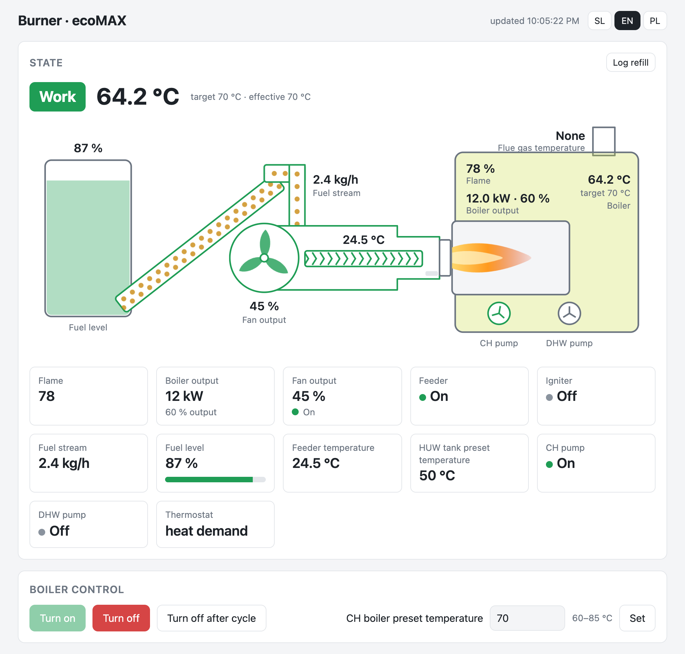
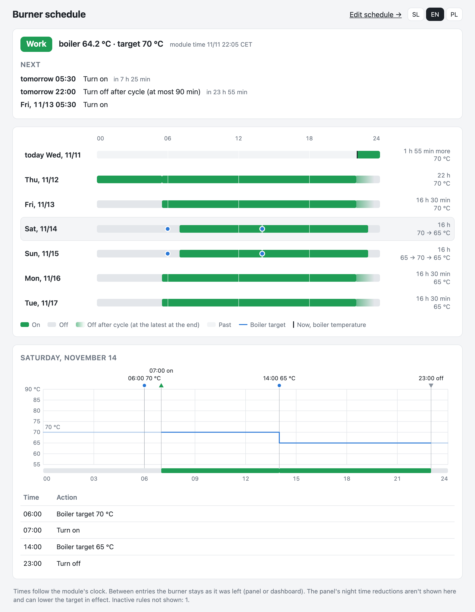

# ecoNET300 local dashboard

A local web dashboard, a burner schedule and a hopper refill log for **ecoMAX pellet-burner controllers** behind a **Plum ecoNET300** module. Everything runs on the module itself, a TP-Link TL-MR3020 v3 with the community `root_eco.bin` firmware. It needs no cloud, no app and no extra server; the n8n refill log is optional.



## Features

| | |
|---|---|
| **Dashboard** (`www/dash.html`) | Burner state with a live drawing of tank, feeder, fan, flame and boiler. Turn on/off, boiler target, user and service parameters (service ones behind the service password), alarms with names, module info, raw data, an output-change log. SL / EN / PL. [docs/dashboard.md](docs/dashboard.md) |
| **Schedule** (`module/econet-sched`, `module/econet-set`) | Timed burner on, off, *turn off after the cycle* and boiler target per weekday, run by cron on the module itself. Edited in the dashboard's Schedule tab. [docs/schedule.md](docs/schedule.md) |
| **Week overview** (`www/plan.html`) | What the schedule will do over the next 7 days: on/off strips, target changes, a day chart. Read-only. |
| **Hopper refill log** (`www/refills.html`, `n8n/`) | Logs how many bags went into the hopper, through an n8n webhook. Charts the usage in kg next to the daily max temperature. The dashboard asks for it when the fuel level jumps up. [docs/refill-log.md](docs/refill-log.md) |
| **Login banner** (`module/econet-status`) | The burner's state under the SSH login banner; `--watch` logs every change of the controller's outputs. |
| **Firmware patches** (`module/patch-*.py`) | The fan, feeder and igniter flags and the raw outputs word in `regParams`. Also keeps the ecoNET app's threads alive across clock jumps. |



## Requirements

- **An ecoMAX controller that speaks the `em` protocol**, e.g. the controllers in many Polish pellet burners. Tested with one controller only, see [Tested with](#tested-with).
- **An ecoNET300 module (TP-Link TL-MR3020 v3) running `root_eco.bin`**, with ecoLINK2 in its USB port and wired to the controller's bus.
  - `root_eco.bin` is Plum's ecoNET 3.2.3678 `em` image with a known root password. It is shared on the Elektroda forum, thread *"Moduł internetowy ecoNet 300 i ecoLINK2"* ([topic3346727](https://www.elektroda.pl/rtvforum/topic3346727.html), forum login needed). MD5 `3f1b64a36ffc5f01a72040fbd4cfd3a7`.
  - It is flashed through the router's TFTP recovery with OpenWrt 19.07.10 in between, then `sysupgrade -n -F root_eco.bin`. That thread has the procedure. Official firmware 3.2.38xx has no root login, so none of this can be installed on it.
- **econet24.com and econet.plumlan.pl blocked on your router, for good.** While the module reaches econet24 it can be force-updated to official firmware at any time. That removes root and everything below. The module's own web UI then stays mostly empty, because its layout comes from the cloud; the dashboard replaces it.
- A computer with `ssh` and `scp` on the same network.
- Optional: an n8n instance for the refill log.

## What changes on the module

Compared with a freshly flashed `root_eco.bin`. The ecoNET app, its API and its web login stay as they are, apart from the two optional patches; everything new sits behind the same lighttpd login.

| Path on the module | Change | Made by | Purpose |
|---|---|---|---|
| `/www/econet/client/dash.html` | added | install, step 2 | the dashboard |
| `/www/econet/client/plan.html` | added | step 2 | week overview of the schedule |
| `/www/econet/client/refills.html` | added | step 2 | hopper refill log page (optional) |
| `/www/econet/client/translate_SL.js` | added | step 2 | Slovenian texts, same keys as the module's `translate_EN.js` |
| `/root/econet-set` | added | step 3 | sets a parameter through the ecoNET app's local FastCGI port; what cron runs |
| `/root/econet-sched` | added | step 3 | schedule service (FastCGI on 127.0.0.1:50008), writes the cron jobs |
| `/etc/init.d/econet-sched` | added | step 3 | starts the schedule service (procd, respawn) |
| `/etc/rc.d/S99econet-sched` | added | step 3 (`enable`) | start at boot |
| `/etc/lighttpd/lighttpd.conf` | **modified**: a marked block appended | step 3 | `fastcgi.server += ( "/schedule" => … 127.0.0.1:50008 )` |
| `/etc/config/system` | **modified**: `zonename`, `timezone` | step 3 | the schedule runs on the module's clock |
| `/etc/crontabs/root` | **modified**: a marked block | econet-sched, on the first save | the schedule's cron jobs; lines outside the block are kept |
| `/etc/econet-schedule.json` | added | econet-sched, on the first save | the schedule entries |
| `/tmp/econet-offafter.json` | added, in RAM | econet-set, while it waits | a running *turn off after cycle*, so the dashboard can show and cancel it |
| `/www/econet/ecomax.py` | **modified**: 5 lines added | `patch-outputs.py`, step 4 | `fanWorks`, `feederWorks`, `lighterWorks`, `feederOuterWorks` and `outputs` in `regParams` |
| `/www/econet/settings.py` | **modified**: 1 line | `patch-interval.py`, step 4 | a negative sleep after an NTP clock jump no longer kills the app's polling thread |
| `/root/econet-status` | added | step 5 | burner state for the login banner, `--watch` output log |
| `/etc/profile.d/econet.sh` | added (with the directory) | step 5 | runs `econet-status` at an interactive SSH login |
| `/etc/sysupgrade.conf` | **modified**: lines appended | step 6 | keep the added files across a settings-keeping sysupgrade |

Recommended as well, not done by this project:

| Path | Change | Why |
|---|---|---|
| `/etc/shadow` | `passwd` | `root_eco.bin`'s root password is public |
| `/etc/config/wireless` | your own network, or `wireless.radio0.disabled=1` | see [Wi-Fi](#wi-fi) |
| the module's web password | change it in the module's web UI | it is `admin`/`admin` after flashing |

The patched `ecomax.py` and `settings.py` are kept as `/root/*.orig`, and the original lighttpd config as `/root/lighttpd.conf.orig`; [Uninstall](#uninstall) puts them back.

## Install

### 1. SSH access

The firmware's dropbear only offers `ssh-rsa`, and macOS `scp` needs `-O` because the module has no SFTP server. An entry in `~/.ssh/config` saves typing:

```
Host econet
    HostName 192.168.1.50            # your module's address
    User root
    HostKeyAlgorithms +ssh-rsa
    PubkeyAcceptedAlgorithms +ssh-rsa
```

Log in once (`ssh econet`) and change the root password with `passwd`. Run all the following commands from this repository's folder.

### 2. Dashboard pages

```sh
scp -O www/dash.html www/plan.html www/refills.html www/translate_SL.js econet:/www/econet/client/
```

Open `http://<module-ip>/dash.html` and log in with the module's web login. The State, Control, parameter, alarm and module views work from here on. The Schedule tab needs step 3.

### 3. Schedule service

```sh
scp -O module/econet-set module/econet-sched econet:/root/
scp -O module/econet-sched.init econet:/etc/init.d/econet-sched
ssh econet
```
On the module:
```sh
chmod +x /root/econet-set /root/econet-sched /etc/init.d/econet-sched
# your timezone: its name and its POSIX rule (OpenWrt's zoneinfo list has both)
uci set system.@system[0].zonename='Europe/Berlin'
uci set system.@system[0].timezone='CET-1CEST,M3.5.0,M10.5.0/3'
uci commit system && /etc/init.d/system reload
/etc/init.d/econet-sched enable && /etc/init.d/econet-sched start
cp /etc/lighttpd/lighttpd.conf /root/lighttpd.conf.orig
cat >> /etc/lighttpd/lighttpd.conf <<'EOF'
# >>> econet-sched: dashboard schedule service
fastcgi.server += ( "/schedule" => (( "host" => "127.0.0.1", "port" => 50008, "check-local" => "disable" )) )
# <<< econet-sched
EOF
lighttpd -t -f /etc/lighttpd/lighttpd.conf && /etc/init.d/lighttpd restart
```

- The block is appended to `lighttpd.conf` itself because that file doesn't include `conf.d`.
- The module needs a correct clock: it has no RTC and boots at 2019-11-20 until NTP (`*.openwrt.pool.ntp.org`) answers. If the router blocks the module's internet, let NTP through or point `system.ntp.server` at your router. The Schedule tab warns when the clock is wrong or cron isn't running.
- Saving the first schedule enables and starts cron.

### 4. Firmware patches (optional, recommended)

```sh
scp -O module/patch-outputs.py module/patch-interval.py econet:/root/
ssh econet
```
On the module:
```sh
cp /www/econet/ecomax.py /root/ecomax.py.orig
cp /www/econet/settings.py /root/settings.py.orig
python /root/patch-outputs.py && python /root/patch-interval.py && /etc/init.d/econet restart
```

Each script prints `patched`, `already patched`, or why it changed nothing. They are safe to run again. Without `patch-outputs.py`, firmware 3.2.3678 reports no fan, feeder or igniter flags, so the dashboard infers the fan and feeder and draws the igniter dashed.

### 5. Login banner (optional)

```sh
ssh econet 'mkdir -p /etc/profile.d'
scp -O module/econet-status econet:/root/
scp -O module/econet-banner.sh econet:/etc/profile.d/econet.sh
ssh econet 'chmod +x /root/econet-status'
```

### 6. Keep the files across a sysupgrade

```sh
ssh econet 'cat >> /etc/sysupgrade.conf' <<'EOF'
/www/econet/client/dash.html
/www/econet/client/plan.html
/www/econet/client/refills.html
/www/econet/client/translate_SL.js
/root/econet-set
/root/econet-sched
/root/econet-status
/etc/init.d/econet-sched
/etc/profile.d/econet.sh
/etc/econet-schedule.json
EOF
```

This only helps with a sysupgrade that keeps settings, and is untested. The lighttpd block, the timezone, the `enable` link and the two patches have to be redone after a firmware change. A forced update to official firmware removes root anyway, which is why the cloud stays blocked.

### 7. Hopper refill log (optional)

Set up the n8n side as described in [docs/refill-log.md](docs/refill-log.md). Then enter the webhook URL and token under *Settings* in `refills.html`, or in the dashboard's *Log refill* dialog. The two pages share them when served from the same address.

## Configuration

| Where | Setting | Default |
|---|---|---|
| `www/dash.html`, top of the script | `HEARTH_BITS`: outputs bits that turn a rotating hearth. `0x10 \| 0x100` on a Pellas X REVO: the drawing then shows the hearth, the burner auger turns with the fan, and the output log names those bits *hearth*. | `0`: 0x10 = circulation pump, 0x100 = exhaust fan, as ecoNET names them |
| `module/econet-status`, top | `HEARTH_BITS`, the same for `--watch` (`272` = 0x110) | `0` |
| `www/refills.html`, top of the script | `WEBHOOK_URL`, `KG_PER_BAG`, `TEMP_SOURCE`, `TEMP_PLACE` | empty, 15 kg, Open-Meteo.com, empty |
| `n8n/temperature.workflow.json`, node *Location* | `LATITUDE`, `LONGITUDE` | must be set |
| the dashboard's language | `?lang=sl\|en\|pl`, else the last choice, else the browser's | |

## Uninstall

On the module:
```sh
/etc/init.d/econet-sched stop; /etc/init.d/econet-sched disable
sed -i '/^# >>> econet-sched/,/^# <<< econet-sched/d' /etc/crontabs/root && /etc/init.d/cron restart
cp /root/lighttpd.conf.orig /etc/lighttpd/lighttpd.conf && /etc/init.d/lighttpd restart
cp /root/ecomax.py.orig /www/econet/ecomax.py
cp /root/settings.py.orig /www/econet/settings.py
/etc/init.d/econet restart
rm -f /www/econet/client/dash.html /www/econet/client/plan.html /www/econet/client/refills.html \
      /www/econet/client/translate_SL.js /root/econet-set /root/econet-sched /root/econet-status \
      /etc/init.d/econet-sched /etc/profile.d/econet.sh /etc/econet-schedule.json
```
Then remove the lines added in step 6 from `/etc/sysupgrade.conf` (`vi /etc/sysupgrade.conf`). The timezone can stay.

## Security notes

- **Everything is behind the module's HTTP login, over plain HTTP.** Keep the module on your LAN; use a VPN (e.g. WireGuard or Tailscale) to reach it from outside. Never forward its ports to the internet.
- **The service lock is only a guard in the page.** The module never checks the service password: anyone with the web login can write any parameter through `/econet/newParam`. The dashboard compares the password with the SHA-512 hash from `/econet/password` in the browser, to prevent accidental edits.
- Every write is checked in the page (number, controller's range, on/off only 0 or 1), confirmed, and read back after a few seconds.
- `/schedule/*` only accepts `application/json` bodies. A form on another website can't post one with your browser's saved login.
- `econet-set` and `econet-status` talk to the ecoNET app on `127.0.0.1:50007` without a password. Only processes on the module itself can reach that port.
- The refill log's token is kept in the browser's local storage and sent only to n8n, in `X-Token`. The module's login is never sent to n8n.
- The firmware also listens on TCP 8765 (`os_health`, no login) and runs dropbear on 22.

### Wi-Fi

The firmware's default Wi-Fi setting is client mode with no network name and no encryption. OpenWrt treats that as *join any open network in range*. Set your own network in the module's web UI, or switch the radio off if the module uses Ethernet:

```sh
uci set wireless.radio0.disabled=1; uci commit wireless; wifi
```

The dashboard's warnings bar flags a module that has joined an unconfigured open network.

## Limitations

- **Burner states** come from `regParams.curr.mode` and follow the order of the `mode…` labels in ecoNET's translation file. On the tested controller, 0, 2, 3, 4, 6, 7 and 12 were confirmed against the panel; the others follow that order. PyPlumIO's state table does not match. See [docs/dashboard.md](docs/dashboard.md#burner-states).
- **Alarm names** are PyPlumIO's ecoMAX codes; only code 0 (power loss) has been confirmed.
- **Fuel level** is calculated by the controller from the feeder's run time. Raw values from 101 up carry an offset of 101 (201 = 100 %), and 255 means unknown.
- **The controller's own schedules** (e.g. the panel's night time reductions) can't be read or changed through the module on the tested controller. The schedule here is separate and runs on the module.
- **What was tested where:**
  - On a real module: the dashboard's reads and writes (turn off, target), `patch-outputs.py` and `econet-status --watch`.
  - Checked only against stand-ins (Python 3, headless Chrome) and not confirmed on a module: turn on from the dashboard, the schedule's cron runs, *turn off after cycle*, the login banner, the week overview, the refill dialog and the `HEARTH_BITS = 0` mode. The module runs Python 2.7; the scripts are written for both.
  - The n8n workflows were imported and run on n8n 2.44.3.

## Tested with

- Controller: Pellas X R.Control (reports `RControl EM892`, ecoMAX `em` protocol, product ID 1), with a Pellas X REVO burner
- Module: ecoNET300 on TP-Link TL-MR3020 v3, `root_eco.bin` (ecoNET 3.2.3678 `em`), ecoLINK2
- Browser checks: headless Chrome at desktop and 400 px phone width, light and dark

## Related projects

- [PyPlumIO](https://github.com/denpamusic/PyPlumIO) talks to ecoMAX controllers directly over RS-485, without an ecoNET module. It has a [Home Assistant integration](https://github.com/denpamusic/homeassistant-plum-ecomax).
- [ecoNET-300 Home Assistant integration](https://github.com/jontofront/ecoNET-300-Home-Assistant-Integration) uses the same local API as this dashboard.

## Credits

- [PyPlumIO](https://github.com/denpamusic/PyPlumIO): ecoMAX alarm names, the fuel-level offset and the outputs bit map.
- The author of `root_eco.bin` and the Elektroda forum thread above.
- Temperature data by [Open-Meteo](https://open-meteo.com/) (CC BY 4.0).

ecoNET, ecoMAX and ecoLINK are trademarks of Plum sp. z o.o. This project is not affiliated with or endorsed by Plum or any burner maker. It changes the firmware of a device that controls a boiler: use it at your own risk. The controller's own safety functions stay in charge.

## License

[MIT](LICENSE)
