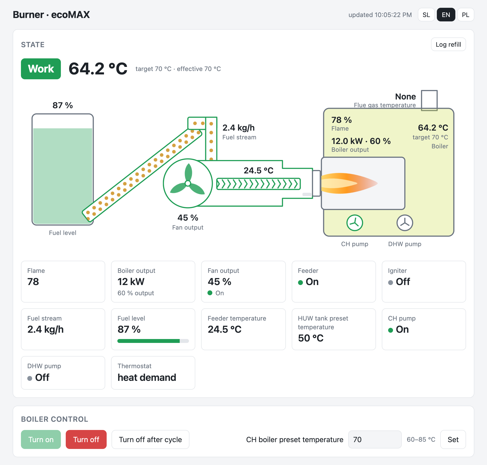
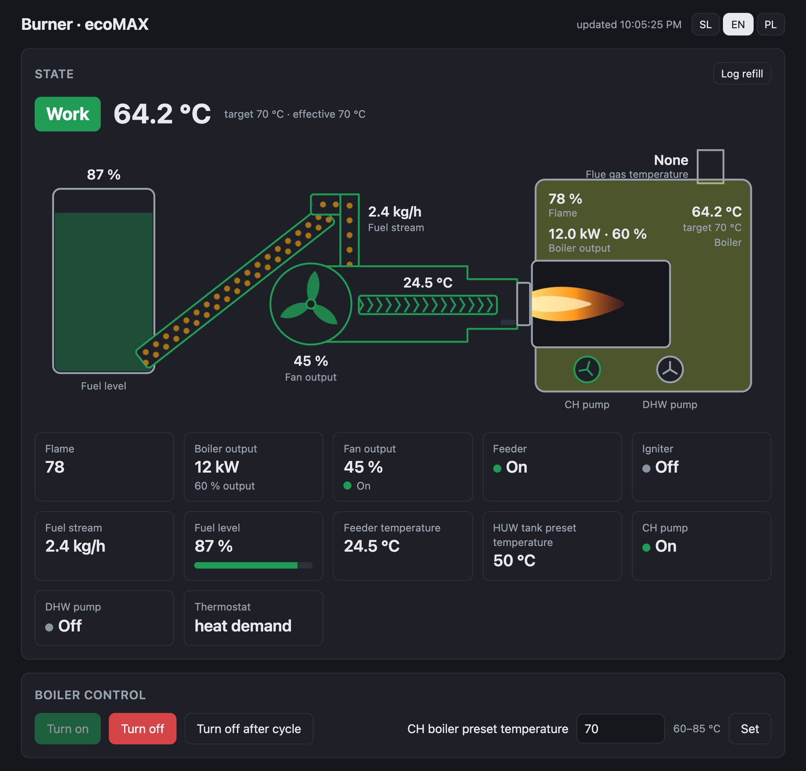
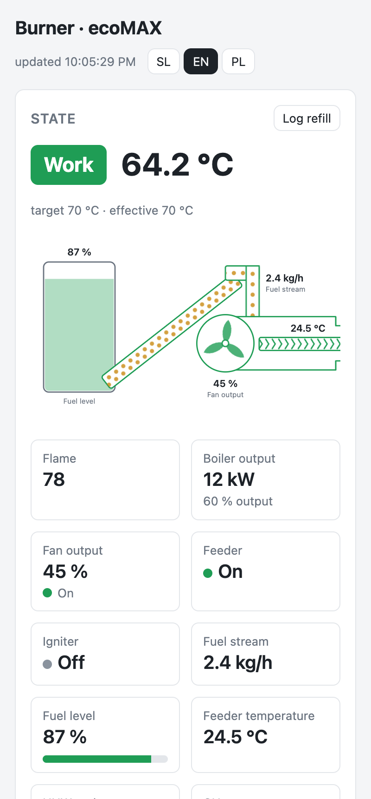

# Dashboard

`www/dash.html` is a single page, served by the module from `/www/econet/client/`. It calls the module's `/econet/*` API on the same origin with the browser's ecoNET login, so it needs no server of its own and stores no password.

| Light | Dark, phone |
|---|---|
|  |   |

## Layout

- Always visible: the warnings bar, **State** and **Control**.
- Below them, tabs: **Alarms · User parameters · Schedule · Service parameters · Module · Current data · Output log**.
  - The open tab is remembered in the browser; `?tab=alarms|user|schedule|service|module|data|watch` picks one.
  - The parameter filter is shared by both parameter tabs.

## Languages

- **SL / EN / PL** in the top right. The choice is remembered in the browser; `?lang=` overrides it, otherwise the browser's language decides.
- Texts come from the module's own translation files wherever a matching entry exists: parameter names, state names, section titles, buttons, alarm-table headings, module labels. EN and PL are the module's `translate_EN.js` and `translate_PL.js`. SL is `translate_SL.js` from this repository: all 997 entries, same keys.
- Only texts without a match live in the page itself, in all three languages: warnings, messages, alarm names, a few labels.
- So EN state names are ecoNET's wording ("Fire up", "Work", "Burning OFF"), which can differ from the panel's.
- If a language file can't be loaded, the page says so and shows English.

## What it shows and does

- **State:** the burner state ([below](#burner-states)), boiler temperature, configured and effective target (the effective one is lower when the panel's night time reduction is active).
- **Burner drawing:** fuel tank with its level, the feeder tube with pellets, the burner with its fan, auger, igniter and flame, and the boiler with temperature, target, flue gas, flame, output (kW and %) and the CH/DHW pumps.
  - Moving parts follow the controller's outputs: the fan turns while on, faster with more air; the feeder's pellets move while the feeder runs; the flame shows when the flame sensor sees one and grows with output; the igniter glows; pumps turn.
  - The water colour goes from blue (20 °C) to red (85 °C), and the burner outline takes the state's colour.
  - Hover over a part for its name and state. Nothing moves when the browser asks for reduced motion.
  - With `HEARTH_BITS` set (a Pellas X REVO: `0x10 | 0x100`), it also draws a rotating hearth, and the burner's auger turns with the fan, as it is geared to it there.
- **Live tiles:** flame, output (kW and %), fan, feeder, igniter, feed rate, fuel level, feeder temperature, hot-water target, CH and DHW pumps, thermostat. Tiles whose values the firmware doesn't report are hidden.
- **Warnings bar:** active alarms and the Alarm state (red). Amber: Wi-Fi joined an unconfigured open network, or a cloud connection is up.
- **Control:** *Turn on* / *Turn off* (`BOILER_CONTROL`; only the one that makes sense is enabled), boiler target within the controller's range, and *Turn off after cycle* ([schedule.md](schedule.md#turn-off-after-cycle)).
- **Alarms:** the latest 10 from `sysParams`, with name, start, end and duration. Names are PyPlumIO's ecoMAX codes.
- **User parameters:** the parameters below section 100, editable.
- **Schedule:** see [schedule.md](schedule.md).
- **Service parameters:** the parameters from section 100 up, grouped as on the panel, locked until unlocked with the service password.
- **Module:** Ethernet and Wi-Fi addresses, cloud connection, ecoNET firmware, controller and its versions.
- **Current data:** the raw API data.
- **Output log:** a row each time the state or an output changes ([below](#output-log)).
- **Hopper refill:** when the fuel level rises, a dialog asks how many bags went in and logs them ([refill-log.md](refill-log.md#dashboard)). *Log refill* next to State opens it by hand.
- **Refresh:** live values every 5 s, parameters every 30 s, module info every 60 s. The module sometimes answers `regParams` with an empty `curr`; the page keeps the last values then.

## Writes and the service lock

- Every write is checked in the page first: a number, within the controller's min–max, on/off only 0 or 1, service parameters only when unlocked.
- Each write asks for confirmation, then reads the value back after about 4 s and reports whether it took.
- **Unlock:** the page fetches `/econet/password` once, the SHA-512 of the controller's service password, and compares it with the SHA-512 of what you type. The hash is computed in the page, because browsers don't offer theirs on plain `http://`. The password is never stored; reloading locks again.
- **The lock only prevents accidental edits from this page.** The module itself never checks the service password.

## Output log

The browser version of `econet-status --watch`.

- Reads `regParams` every second while the tab is open and the page is visible.
- One row per change, each with: what changed and how long the previous state lasted (`≥` when it began before the log); boiler temperature, flame and fan; every output that is on, with the outputs word.
- Filter chips per output and for the state pick which changes show; the choice is remembered.
- *Download* saves the shown rows as text in the `--watch` format, with English names.
- The log lives in the browser window only (at most 5000 changes). For a long unattended log, run `econet-status --watch` with `nohup` on the module.
- Without the `outputs` word ([patch](#firmware-patches)) it uses the on/off flags the firmware reports.

## Login banner

`module/econet-status` prints the burner's state under the OpenWrt banner when you log in over SSH:

```
 Burner:  Work (3)      boiler 64.2 °C (target 70 °C)
 Flame:   78 %          output 12.0 kW (60 %), fan 45 %
 Fuel:    87 %          feed 2.4 kg/h, feeder 24.5 °C, flue gas -
 Turns off after the cycle: waiting since 22:00, at the latest at 23:30
 -----------------------------------------------------
```

- It is a plain `sh` script. It sends the running ecoNET app the same FastCGI request `econet-set` uses (`printf | nc` to 127.0.0.1:50007, no password) and reads the reply with `awk` and `sed`. A login therefore doesn't wait for Python, and no extra service runs.
- It gives up after 2 s if the app hangs. OpenWrt's busybox `nc` has no `-w`, so a background timer stops it.
- It only runs in an interactive terminal, so `scp` isn't affected.

`econet-status --watch [SECONDS]` instead prints a timed line each time the state or an output changes, checking every SECONDS (default 1; 0 = without pause) until Ctrl-C. Use it to find out which output drives which motor:

```
22:03:59  Work (3)  outputs 0x0017: fan feeder CH-pump circ-pump
22:04:01  Work (3)  outputs 0x0005: fan CH-pump
22:04:02  Work (3)  outputs 0x0007: fan feeder CH-pump
```

## Burner states

`regParams.curr.mode`. The numbers follow the order of the `mode…` labels in ecoNET's own translation file; the names here are ecoNET's.

| `mode` | State | Confirmed on a panel |
|---|---|---|
| 0 | Off | ✅ |
| 1 | Stopped | |
| 2 | Fire up (includes the flame test and ignition) | ✅ |
| 3 | Work | ✅ |
| 4 | Supervision (target reached, feeder off, small flame kept) | ✅ |
| 5 | Halted | |
| 6 | Cleaning | ✅ |
| 7 | Burning off | ✅ |
| 8 | Alarm | |
| 9 | Manual (the panel's manual control) | ✅ |
| 10 | Unsealing | |
| 11 | Other | |
| 12 | Stabilization | ✅ |
| 13 | Purge | |
| 14 | Check flame | |
| 15 | Flame extinguished | |
| 16 | Prevention | |
| 17 | Work grate | |
| 18 | Supervision grate | |
| 19 | Calibration | |
| 20 | Chimney sweep | |
| 21 | Open door | |

A typical start: Off (0) → Fire up (2) → Cleaning (6) → Fire up (2, ignition) → Stabilization (12) → Work (3), about 8 minutes on the tested burner. `BOILER_CONTROL = 0` always goes through Burning off (7). PyPlumIO's `DeviceState` table does not match these numbers (it calls 6 "standby" and has no 12).

## Outputs

The controller's outputs word, as ecoNET 3.2.3879 names its bits. `patch-outputs.py` adds the word to `regParams` as `outputs`; the dashboard and `econet-status --watch` name the bits this way.

| Bit | Name | Flag in `regParams` |
|---|---|---|
| 0x01 | fan | `fanWorks` (patch) |
| 0x02 | feeder | `feederWorks` (patch) |
| 0x04 | CH pump | `pumpCOWorks` |
| 0x08 | DHW pump | `pumpCWUWorks` |
| 0x10 | circulation pump, or the hearth with `HEARTH_BITS` | `pumpCirculationWorks` |
| 0x20 | igniter | `lighterWorks` (patch) |
| 0x40 | alarm | |
| 0x80 | outer boiler | |
| 0x100 | exhaust fan, or the hearth in manual control with `HEARTH_BITS` | |
| 0x200 | additional feeder | |
| 0x400 | outer feeder | `feederOuterWorks` (patch) |
| 0x800 | solar pump | `pumpSolarWorks` |
| 0x1000 | fireplace pump | `pumpFireplaceWorks` |
| 0x2000 | GZC contact | `contactGZCActive` |
| 0x4000, 0x8000 | blow fans | |

What a bit actually drives depends on the burner. On a Pellas X REVO, 0x02 is the hopper feeder and 0x10 turns the rotating hearth (there is no circulation pump). 0x40 is on all the time and 0x200 comes on with the fan. Use the output log or `--watch` with the panel's manual control to find out on yours.

## Firmware patches

Both scripts edit the ecoNET app's Python files in `/www/econet/`, only add or change lines when they're missing, and are safe to run again. A firmware update or reflash undoes them.

**`patch-outputs.py`** adds five lines to `ecomax.py`, next to the pump flags that 3.2.3678 already decodes: `fanWorks`, `feederWorks`, `lighterWorks` and `feederOuterWorks` decoded as in 3.2.3879 and PyPlumIO, plus the whole outputs word as `outputs`. `regParams.curr` is the app's data object serialized as JSON, so the new attributes appear in the API without further changes.

**`patch-interval.py`** changes one line in `settings.py`. The app's periodic threads sleep "period minus the time the job took". After the module boots at 2019-11-20, the first NTP step moves the clock forward by years mid-job. That number is then negative, Python 2.7 raises `IOError` 22 outside the `try`, and the thread ends: the network part of `sysParams` stops updating, and the watchdog thread can die the same way. 3.2.3879 skips negative sleeps; the patch does the same and also caps the sleep at the period, so a backward jump can't stall the loop.

## ecoNET endpoints used

All are GET requests to `/econet/<name>` with the module's HTTP Basic login.

| Endpoint | Used for |
|---|---|
| `regParams` | live values (`curr`) |
| `editParams` | parameters with value, min, max, unit and section |
| `sysParams` | module info, network, controller, versions, alarms |
| `password` | SHA-512 of the service password, for the lock |
| `newParam?newParamName=…&newParamValue=…` | writes; `BOILER_CONTROL` 1/0 switches the burner (it is not in `editParams`, and the module doesn't range-check it) |

`newParam` answers `"result": "OK"` as soon as the request is queued; the page reads the value back to know it took. The page never calls the endpoints that change the module itself (`updateSoftware`, `setSysParams`, `changePassword`, …).
