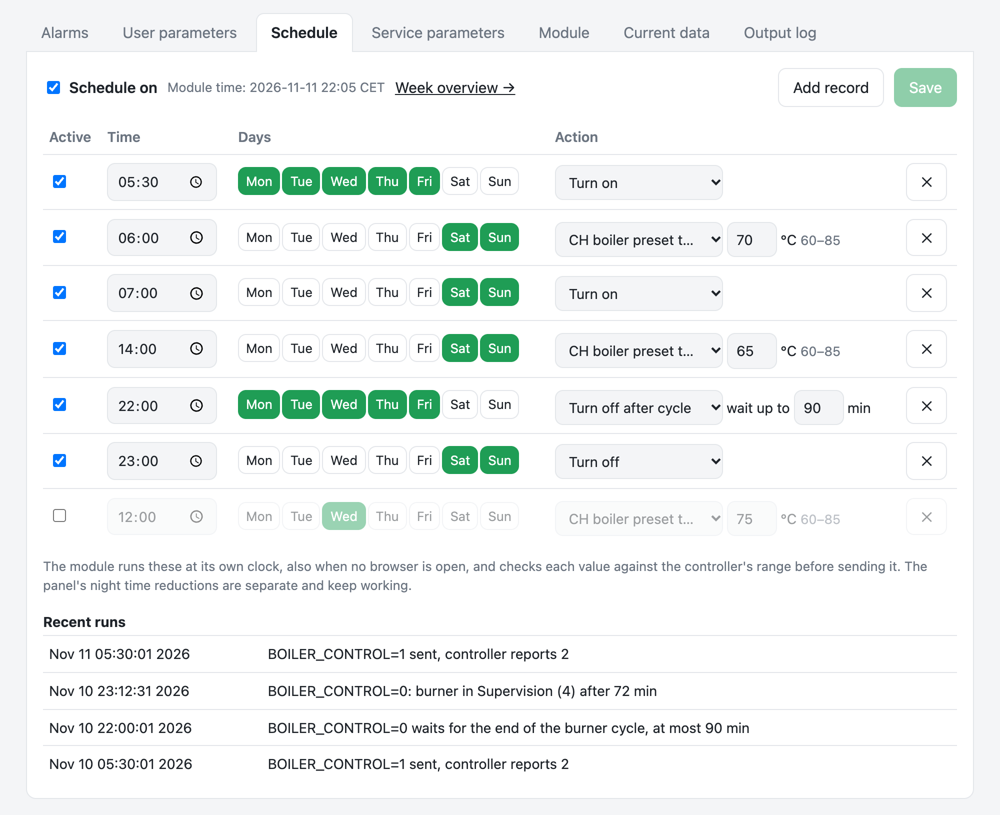
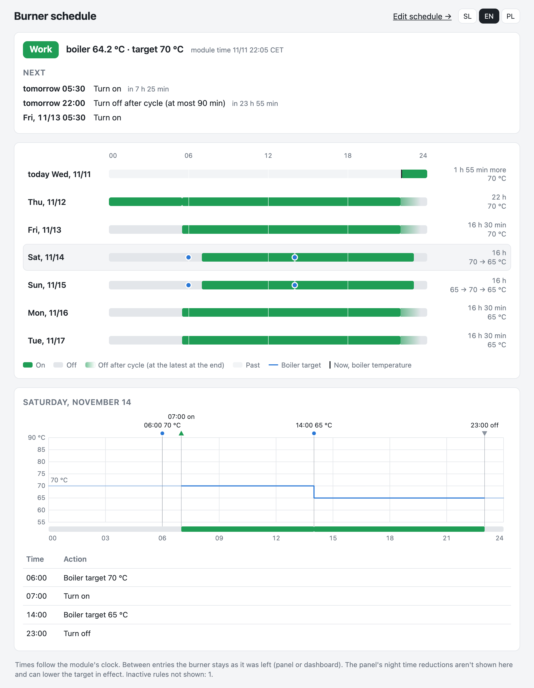

# Schedule

Timed burner actions per weekday, run by the module itself, so they work with no browser open. They are edited in the dashboard's **Schedule** tab and shown for the coming week in `plan.html`.



The controller's own schedules (on the tested controller, the panel's "night time reductions") can't be read or changed through the module (`schedulesVer` 0, `getSchedule` empty). This schedule is separate; the panel's own settings keep working alongside it.

## How it works

```
dash.html ──/schedule/*──▶ lighttpd ──FastCGI :50008──▶ econet-sched ──▶ /etc/econet-schedule.json
                                                                     └──▶ /etc/crontabs/root (marked block)
crond ──▶ econet-set NAME VALUE ──FastCGI :50007──▶ ecoNET app ──▶ controller
```

- **`econet-sched`** is a small WSGI app on flup (FastCGI on 127.0.0.1:50008), started by `/etc/init.d/econet-sched` under procd.
  - It keeps the entries in `/etc/econet-schedule.json`.
  - It writes them as cron jobs into a marked block of `/etc/crontabs/root`; lines outside the block are kept.
  - lighttpd forwards `/schedule/*` to it, behind the module's login.
- **`econet-set NAME VALUE`** is what cron runs.
  - It talks to the ecoNET app's own FastCGI port (127.0.0.1:50007, the one lighttpd forwards `/econet/*` to), so it needs no password.
  - It refuses values outside the controller's range, sends the value (up to 3 tries) and reads it back.
  - Each run writes one line to syslog: `logread -e econet-set`. The Schedule tab shows the latest as *Recent runs*.
- **Times use the module's clock.** It needs the right timezone and NTP (see the README, install step 3). The tab shows the module's time and warns when the clock is wrong (year before 2025) or cron isn't running.

## The Schedule tab

- **Actions:** turn on, turn off, turn off after cycle (with its own wait limit, 5–240 min), boiler target (`CO_TEMP_SET`, within the controller's range).
- **Days:** any combination of weekdays per entry.
- **Active** box per entry: switches that entry on or off at once (`/schedule/entry`), without Save and without touching other unsaved edits. A switched-off entry is greyed and has no cron line. A new, unsaved entry's box applies on Save.
- **Schedule on** at the top switches the whole schedule off without losing the entries; the cron block then holds only a comment. It applies at once.
- Fetched only while the tab is open: once when it's opened, then every 60 s.
- *Week overview →* opens `plan.html`.

## Turn off after cycle

`BOILER_CONTROL = 0` is safe at any moment: the controller always runs its burning-off (state 7). Switching off during firing up (2, 6, 12) wastes the ignition, though, and can leave unlit pellets in the burner. During Work (3) the burner is full of fuel, so the burn-off is longest. At Supervision (4) the boiler has reached its target, the feeder is off and only embers are left.

`econet-set BOILER_CONTROL 0 --after-cycle 90` therefore waits:

- It checks every 30 s and sends the off as soon as the burner is in Off (0), Stopped (1), Supervision (4), Halted (5) or Burning off (7).
- If the burner is still busy after 90 min (a cold day can keep it in Work for hours), it sends the off anyway.
- The log says which happened.
- While it waits, it records itself in `/tmp/econet-offafter.json`. The dashboard then shows *waiting since … until …* with **Cancel**, whether the wait came from a schedule entry or from the *Turn off after cycle* button. Only one wait runs at a time.

## Week overview



`plan.html` shows in one picture what the schedule will do: today and the next 6 days, when the burner is planned on or off and at which boiler target. It only reads (`/schedule/get`, `regParams`, `editParams`) and changes nothing. Open `http://<module-ip>/plan.html`.

- **Now:** state, boiler temperature, target (and the effective one, if the panel lowers it), a waiting turn-off-after-cycle, the module's clock, and the next 3 entries with how long until each.
- **Week:** one strip per day, 00–24.
  - Green = planned on; grey = off; fading green = turning off after the cycle, with the off at the latest at the end of the fade.
  - Pale = already past today; black line = now; blue dots = target changes.
  - Beside each day: the planned time on, and the target(s).
- **Day:** tap a strip for that day's chart: the planned target as a step line, the same on/off band, a flag per entry, and on today the now-line with the boiler temperature. A table of the day's entries is underneath.
- **How it's projected:** it starts from the burner as it is now (on unless Off or Burning off) and the current target. Then it applies each active entry in time order. Changes made on the panel or in the dashboard between entries are not foreseen.
- The page must not be renamed to anything starting with `schedule`. lighttpd's `"/schedule"` rule matches by prefix and would hand `/schedule….html` to the schedule service.

## API

All requests go through lighttpd behind the module's login. POST bodies must be `application/json`, so a plain form on another website can't post one with your saved login.

| Request | Body | Does |
|---|---|---|
| `GET /schedule/get` | | the entries, `enabled`, the module's time and timezone, `clockOk`, `cron`, recent runs, a pending turn-off |
| `POST /schedule/set` | `{"entries": [...]}` | replaces the schedule (at most 50 entries) |
| `POST /schedule/enable` | `{"enabled": false}` | switches the whole schedule off or on, entries kept |
| `POST /schedule/entry` | `{"id": "1a2b3c4d", "on": false}` | switches one entry off or on |
| `GET /schedule/pending` | | the running turn-off-after-cycle, or `null` |
| `POST /schedule/offafter` | `{"wait": 90}` | turn the burner off when its cycle ends, at most after `wait` minutes |
| `POST /schedule/cancel` | `{}` | cancels that wait (also one started by cron) |

An entry:
```json
{"id": "1a2b3c4d", "on": true, "time": "05:30", "days": [1, 2, 3, 4, 5],
 "action": "on" | "off" | "off_after" | "target", "value": 65, "wait": 90}
```
- `id`: given by the service; 8 hex digits.
- `days`: cron's numbering, 0 = Sunday … 6 = Saturday.
- `value`: only for `target`.
- `wait`: only for `off_after`, 5–240 minutes.

Errors are `400 {"error": "..."}`.

## Notes for changing the scripts

- The module runs **Python 2.7**. `econet-set` and `econet-sched` are written to run on both 2.7 and 3, so they can be tested on a desktop.
- The module's flup (`/usr/lib/python2.7/site-packages/flup/server/fcgi_base.py`) is patched by Plum to write the app's result in one piece and asserts it is a `str`. A WSGI app on the module must therefore **return the body itself, not a list**, or flup answers 500 "Unhandled Exception".
- `/etc/lighttpd/lighttpd.conf` doesn't include `conf.d`, so the FastCGI rule is appended to the file itself.
- OpenWrt's busybox `nc` has no `-w` option, and the firmware has no `curl`, `wget`, `base64` or `timeout`.
